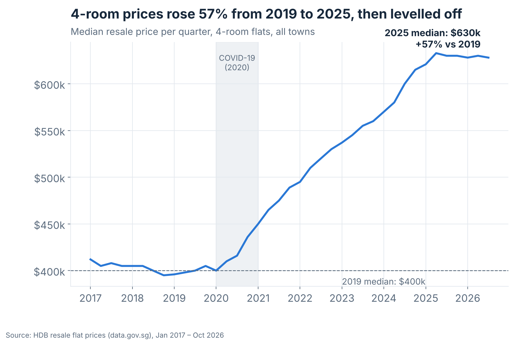
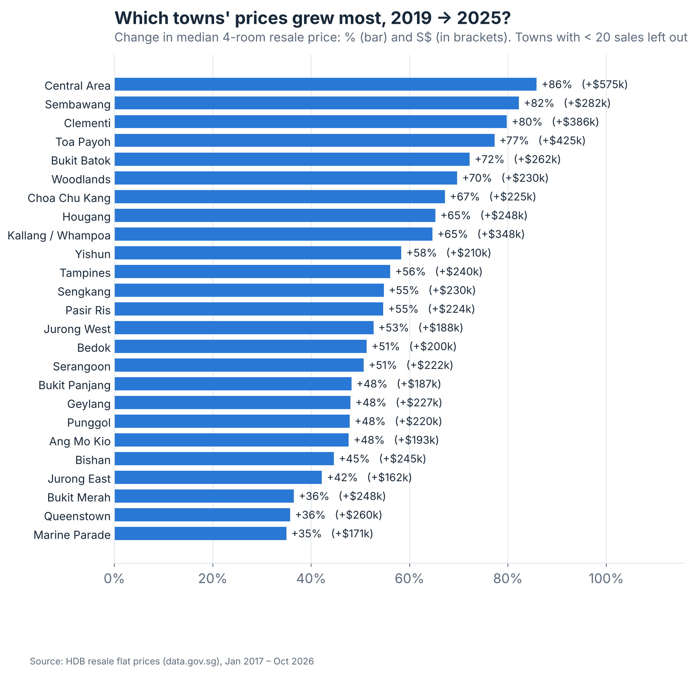
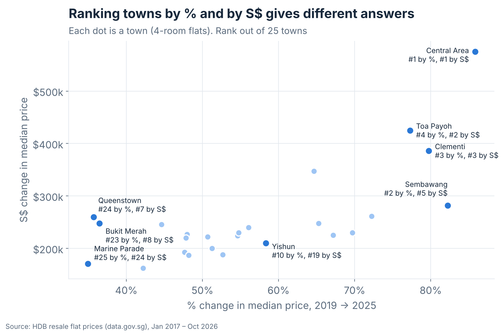
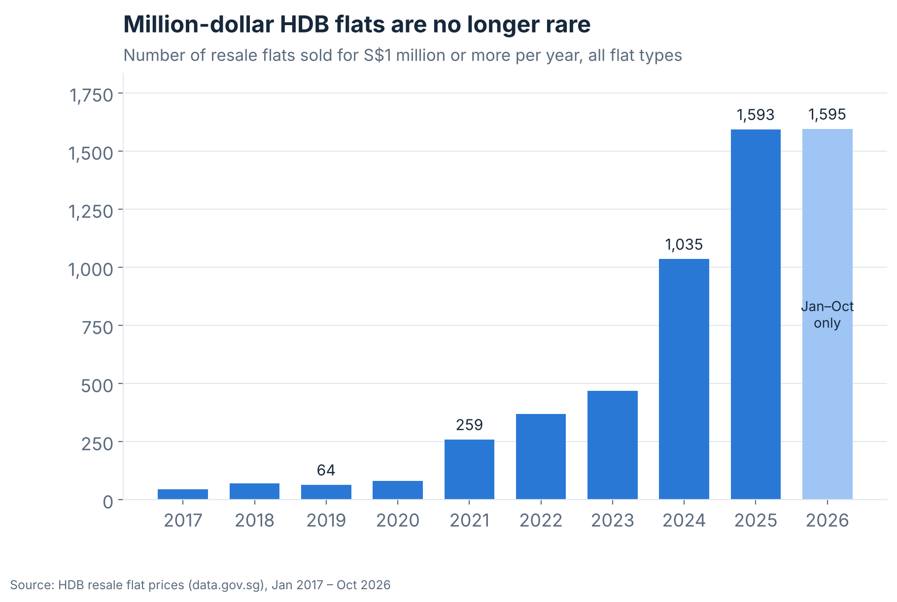
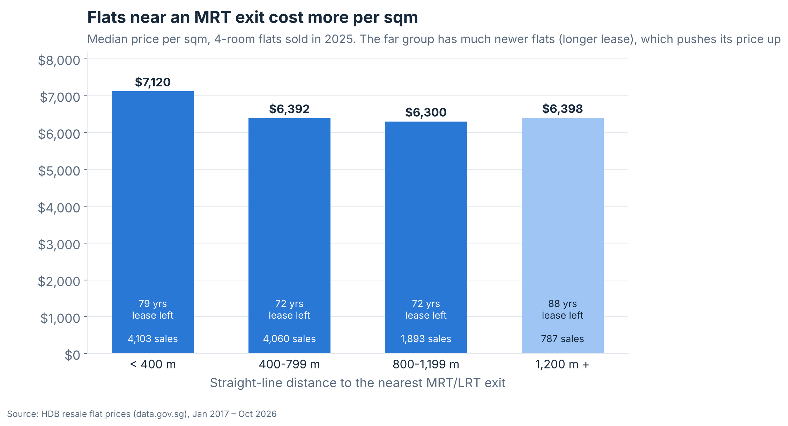
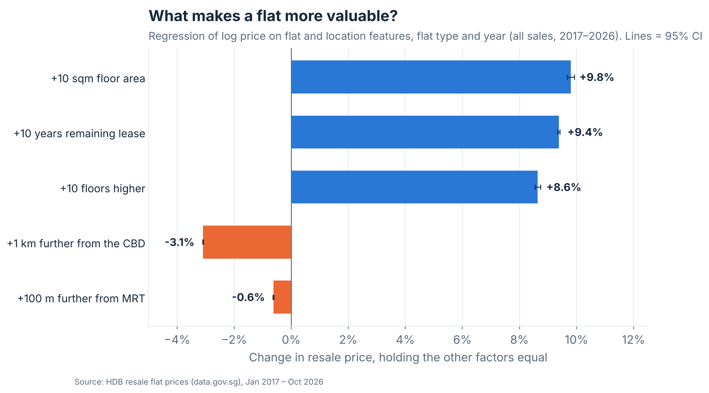
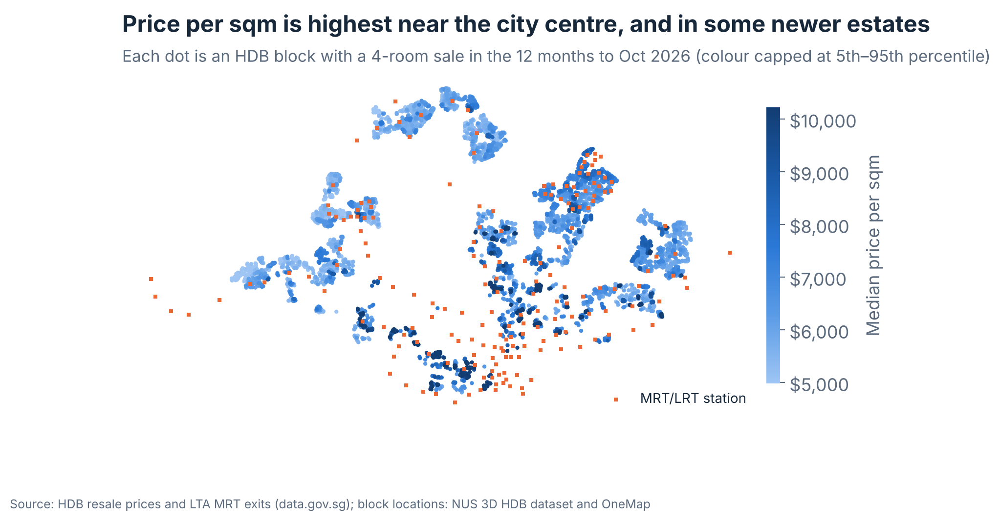

# HDB Resale Prices in Singapore (2017–2026)

**Which towns' HDB prices rose most after COVID, why are some flats and places worth more, and which towns fit a buyer's budget?**

DS608 Data Analytics for Economics · Group project · Singapore Management University, MSc in Data Science (MDSE)

**Group members:** Ma Tianjiao · Sun Jiayi · Deng Shenbojia

**Live dashboard:** _link will be added after deployment on Streamlit Community Cloud_

> This repository is our project report. It contains the code, data documentation, results and limitations.
> This project was completed as **MDSE group work**; see [CONTRIBUTIONS.md](CONTRIBUTIONS.md) for who did what.

---

## 1. Motivation

As international students, one of the first things we had to do in Singapore was find a place to rent, and rent depends a lot on how expensive an area is. Most Singapore residents live in HDB flats, and every resale transaction is published as open data. We also kept hearing that prices went up sharply after COVID, so we wanted to check this with real data and understand **what makes some flats and places more expensive than others**.

## 2. Research questions

1. **Growth:** Which towns saw the biggest increase in HDB resale prices after COVID (2019 vs. later years)?
2. **Drivers:** Why are some flats and locations more valuable? We look at the flat itself (remaining lease, floor level, size) and its location (mature estate, distance to the nearest MRT station, distance to the city centre).
3. **Decision support:** Can a dashboard help a buyer (or a renter estimating costs) find towns and blocks that fit their budget and needs?

Questions 2 and 3 were expanded after feedback from our TA on the proposal.

## 3. Data

| Dataset | Publisher | What we use it for | Licence |
|---|---|---|---|
| [Resale flat prices based on registration date from Jan-2017 onwards](https://data.gov.sg/datasets/d_8b84c4ee58e3cfc0ece0d773c8ca6abc/view) | HDB, via data.gov.sg | All resale transactions (~242,000 rows) | Singapore Open Data Licence |
| [LTA MRT Station Exit (GeoJSON)](https://data.gov.sg/datasets/d_b39d3a0871985372d7e1637193335da5/view) | LTA, via data.gov.sg | Location of every MRT/LRT exit | Singapore Open Data Licence |
| [3D city model of Singapore HDB buildings](https://github.com/ualsg/hdb3d-data) (v2019-08-25) | NUS Urban Analytics Lab (from HDB, OpenStreetMap and OneMap data) | Location of ~90% of HDB blocks | MIT |
| [OneMap Search API](https://www.onemap.gov.sg/apidocs/) | Singapore Land Authority | Location of the remaining (newer) blocks | OneMap Terms of Use |

Full details, column descriptions and known limitations: [data/DATA_SOURCES.md](data/DATA_SOURCES.md).

**What is (and is not) in this repository**

- `data/raw/hdb_resale_2017_onwards.csv` (24 MB) is **not tracked**; `src/download_data.py` downloads it.
- `data/raw/mrt_station_exits.csv` (small) **is tracked**.
- `data/external/hdb3d_block_centroids.csv` and `data/external/block_coordinates.csv` **are tracked**, because rebuilding them means a 90 MB download and a slow OneMap lookup.
- `data/processed/hdb_resale_clean.parquet` **is tracked** so that the online dashboard can run; it can be rebuilt with `src/wrangle.py`.

The HDB data are updated regularly. Our results use the version downloaded on **12 October 2026** (Jan 2017 – Oct 2026). Running the download again later will give slightly different numbers.

## 4. Repository structure

```
.
├── README.md                 Project report (this file)
├── AI_USAGE.md               How we used generative AI
├── CONTRIBUTIONS.md          Who did what
├── app.py                    Streamlit dashboard
├── .streamlit/config.toml    Dashboard colours and fonts (theme)
├── requirements.txt          Python packages
├── data/
│   ├── DATA_SOURCES.md       Data documentation
│   ├── raw/                  Original downloads (HDB CSV is not tracked)
│   ├── external/             Block coordinates from OneMap
│   └── processed/            Analysis-ready parquet file
├── src/
│   ├── download_data.py      1. Download HDB resale data
│   ├── check_data.py            Quick look at the raw data
│   ├── download_mrt.py       2. Download MRT exit locations
│   ├── building_coords.py    3a. Block locations from the NUS 3D HDB dataset
│   ├── geocode_blocks.py     3b. Remaining block locations (OneMap)
│   ├── wrangle.py            4. Clean data and add new variables
│   ├── make_tables.py        5. Summary tables used in this README
│   └── make_figures.py       6. Figures used in this README and the presentation
└── outputs/
    ├── tables/               Generated tables (CSV)
    ├── figures/              Figures (PNG) used in this README and the presentation
    └── presentation/         Presentation deck
```

## 5. How to reproduce

Requires Python 3.10+. Run all commands from the project root folder.

```bash
# 1. Create and activate a virtual environment
python -m venv .venv
source .venv/Scripts/activate      # Git Bash on Windows
# source .venv/bin/activate        # macOS / Linux

# 2. Install packages
pip install -r requirements.txt

# 3. Get the data and build the processed file
python src/download_data.py        # HDB resale data -> data/raw/
python src/download_mrt.py         # MRT exits -> data/raw/
python src/building_coords.py      # optional: block locations are already in data/external/
python src/geocode_blocks.py       # optional: same
python src/wrangle.py              # -> data/processed/hdb_resale_clean.parquet
python src/make_tables.py          # -> outputs/tables/
python src/make_figures.py         # -> outputs/figures/ (run after make_tables.py)

# 4. Start the dashboard
streamlit run app.py
```

`geocode_blocks.py` only looks up addresses that are not yet in `data/external/block_coordinates.csv`, so after a new HDB download it only needs to look up new blocks. OneMap limits searches without an account, so the script deliberately goes slowly (about 1 search per second). With a free OneMap API token saved in a `.env` file as `ONEMAP_TOKEN=...` it can run faster; `.env` is in `.gitignore` and is never uploaded.

## 6. Approach

**Cleaning (`src/wrangle.py`).** Convert `month` to a date; turn text such as `"61 years 04 months"` into 61.33 years; turn `"10 TO 12"` into floor 11; add price per square metre, flat age, mature/non-mature estate (HDB's official list of 15 mature estates), remaining-lease bands and a $1M+ flag.

**Location.** Each block address (block number + street) is matched to the centre of that building in the NUS 3D HDB dataset; blocks completed after mid-2019 are not in that dataset and are looked up with OneMap instead. We then compute the straight-line distance from each block to the **nearest MRT/LRT exit**, and to **Raffles Place** (as the centre of the CBD).

**Analysis.**
- We use **medians** rather than means, so a few very expensive flats do not pull results up.
- We compare **the same flat type** (mainly 4-room, the most common) to keep comparisons fair.
- **Comparing prices across years.** For each town and year we take the median **price per square metre** (or, optionally, the median total price). Each later year is compared with **2019**, the last full pre-COVID year:
  - **% change** = (median in year ÷ median in 2019 − 1) × 100
  - **S$ change** = median in year − median in 2019

  We report **both**, because ranking towns by % change does not identify the towns with the largest increases in dollars (see Findings).
- **Only full years are compared.** 2026 only covers January–October, so it is excluded from every year-to-year comparison (it appears only in the quarterly trend chart if the user selects it, and in the map and "Help me choose" tab, which use the last 12 months).
- Towns with fewer than 20 sales in either year are excluded from rankings.
- **Comparing like with like.** Besides flat type and price per sqm, the dashboard lets users restrict the **remaining lease** and **floor level** ("Compare similar flats only"), since both affect prices. The dashboard's **About & method** tab explains all of this.
- To separate overlapping factors (e.g. central flats are also older), we fit a **regression**:
  `log(price) ~ floor area + remaining lease + floor level + MRT distance + CBD distance + flat type + year`
  (OLS with robust standard errors). With log price, a coefficient *b* means about `100 × (exp(b) − 1)` % change in price.

## 7. Dashboard

| Tab | Question it answers |
|---|---|
| 📈 Overview | Key takeaways; % and S$ change since 2019, year by year; quarterly price trend in chosen towns; growth of $1M+ flats |
| 🏙️ Town growth | Which towns grew most since 2019, ranked by **% or S$ change**? Did cheaper towns catch up? |
| 🔍 Why are some flats pricier? | Lease, floor, mature estate, MRT distance, CBD distance, and the regression putting them together |
| 🗺️ Map | Where are flats most expensive per sqm? Where are MRT stations? |
| 💰 Help me choose | Which towns fit my budget, minimum lease and MRT distance? Which blocks sold within budget? |
| 📄 Data | Filtered data table and CSV download |
| ℹ️ About & method | Research questions, how prices are compared across years, how we keep comparisons fair, limitations, sources |

Sidebar filters: flat type, price measure (per sqm or total), years, towns, and **Compare similar flats only** (remaining lease and floor level).

## 8. Key findings

_The numbers below come from `python src/make_tables.py` and the charts from `python src/make_figures.py` (data up to Oct 2026)._

### 1. Prices rose a lot, and unevenly



- The median **4-room** resale price rose from **$400,000 (2019)** to **$630,000 (2025)**: **+$230,000, +57%**. Per square metre it rose from $4,188 to $6,634 (+58%). The rise was steady: +6% by 2020, +19% by 2021, +39% by 2023 and +58% by 2025 (per sqm, [table](outputs/tables/yearly_change_vs_2019_4room.csv)).
- Growth differed widely between towns ([table](outputs/tables/town_growth_4room.csv)). In **%** terms, **Central Area +86%**, **Sembawang +82%**, **Clementi +80%** and **Toa Payoh +77%** grew most; **Marine Parade +35%**, **Queenstown +36%** and **Bukit Merah +36%** grew least.


- **% and S$ rankings differ.** Queenstown ranks 24th of 25 towns by % change but **7th in dollars (+$260,000)**, and Bukit Merah 23rd by % but 8th in dollars (+$248,000), because they started from high prices. Sembawang is 2nd by % but 5th in dollars (+$282,000), and Yishun 10th by % but 19th in dollars (+$210,000).


- Several cheaper towns (Sembawang, Woodlands, Bukit Batok, Choa Chu Kang) grew faster than the most expensive ones, but the link is weak and part of it is a *mix effect* (newer flats entering the resale market).
- **Million-dollar HDB flats** went from **64 sales in 2019 to 1,593 in 2025** ([table](outputs/tables/million_dollar_flats.csv)).



### 2. What makes a flat more valuable?

Comparing flats one factor at a time (4-room, 2025, [table](outputs/tables/mrt_band_4room_2025.csv)):

| Distance to nearest MRT/LRT exit | Median price per sqm | Median lease left | Sales |
|---|---|---|---|
| < 400 m | $7,120 | 79 years | 4,103 |
| 400–799 m | $6,392 | 72 years | 4,060 |
| 800–1,199 m | $6,300 | 73 years | 1,893 |
| 1,200 m + | $6,398 | 89 years | 787 |



Flats within a 5-minute walk of an MRT exit cost about **11% more per sqm** than flats 1.2 km+ away. The far group looks surprisingly expensive only because it contains many **new flats with long leases** (median 89 years left), which shows why we need to hold other factors equal.

**Regression** (all flat types, 2017–2026, 242,454 sales, R² = 0.89, [table](outputs/tables/regression_effects.csv)). Holding the other factors equal:

| Factor | Change in price | 95% CI |
|---|---|---|
| +10 sqm floor area | +9.8% | 9.7% to 9.9% |
| +10 years remaining lease | +9.4% | 9.3% to 9.4% |
| +10 floors higher | +8.6% | 8.6% to 8.7% |
| +100 m further from MRT | −0.6% | −0.64% to −0.61% |
| +1 km further from the CBD | −3.1% | −3.1% to −3.1% |



For example, an otherwise identical flat 1 km from the MRT instead of next to it sells for roughly 6% less, and one 10 km further from the CBD for roughly 27% less. These are associations, not causal effects (see Limitations).

Mapped by block, the most expensive flats per sqm cluster near the city centre, but some newer estates further out (e.g. in the north-east) are also expensive per sqm, consistent with the lease effect above.



### 3. Helping someone choose

The *Help me choose* tab turns these findings into a decision tool: a user sets a **budget**, a **minimum remaining lease** and a **maximum distance to the MRT**, and sees which towns had most recent sales within budget, plus a shortlist of specific blocks. For example, with $650,000, at least 60 years of lease and any MRT distance, at least half of recent 3-room sales were within budget in 11 towns, mostly in the north, north-east and west.


## 9. Limitations

- **Resale prices are not rents**, so they only give a rough idea of how expensive an area is to live in.
- **Prices are nominal**, not adjusted for inflation.
- **Mix effects:** a town's median can rise because different flats are sold (e.g. newer flats reaching the 5-year minimum occupation period), not only because the same flats became more expensive.
- **Distances are straight lines**, not walking routes, and use **today's MRT network** for all years (stations opened during 2017–2026, e.g. on the Thomson–East Coast Line, are counted for earlier sales too).
- Block locations come from two sources (building centres from the NUS dataset, and OneMap address points for newer blocks). Both are accurate to within a few metres, which is small compared with our distance bands. Any address that could not be matched has no location and is left out of the location charts and regression.
- The regression shows **associations, not causes**. Unobserved factors (schools, views, renovation, nearby malls) may be linked to both location and price.
- The data cover **HDB resale flats only**, not new BTO flats or private property.

## 10. AI usage and contributions

- Generative AI use is documented in [AI_USAGE.md](AI_USAGE.md).
- Individual contributions are documented in [CONTRIBUTIONS.md](CONTRIBUTIONS.md).

## 11. Acknowledgements

Data: Housing & Development Board and Land Transport Authority via data.gov.sg (Singapore Open Data Licence); Singapore Land Authority OneMap; NUS Urban Analytics Lab 3D HDB dataset (Biljecki 2020, MIT licence), which itself uses HDB, OpenStreetMap contributors and OneMap data. Built with pandas, statsmodels, Plotly Express and Streamlit for DS608 (Prof. Daniel Preve), SMU MDSE.
